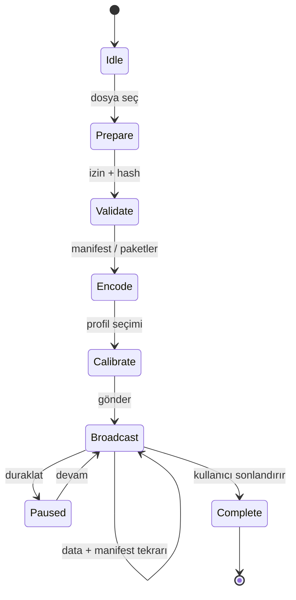
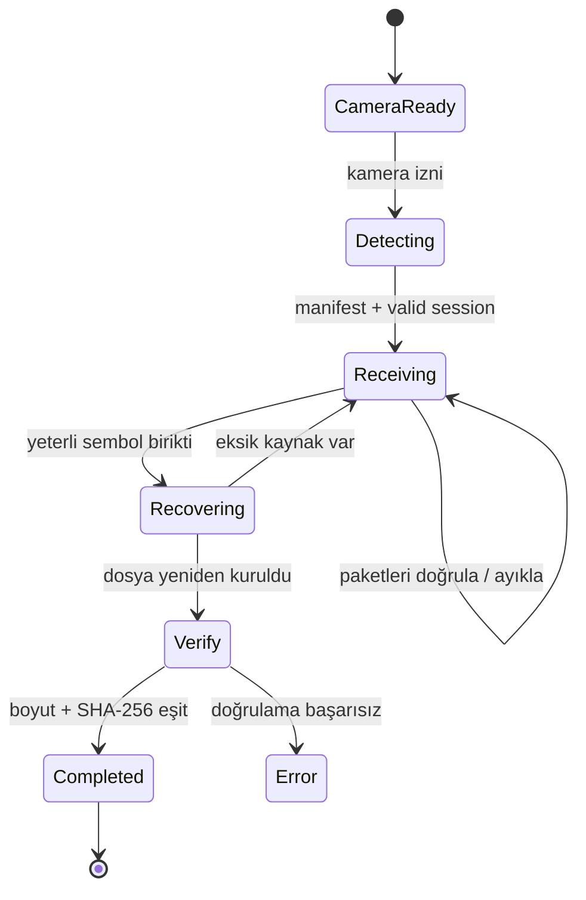

# LIGHTBRIDGE

> **Optical Data Transfer Protocol — Teknik Tasarım, Hızlandırma ve Ar-Ge Dosyası**  
> **Sürüm:** Tasarım dokümanı v1.0 · **Tarih:** 31 Ekim 2026  
> **Hedef:** macOS ekranı → iPhone kamerası, ağsız optik dosya aktarımı  
> **Durum:** **Ürün konsepti / teknik tasarım**. Bu belge, uygulamanın tamamlandığını veya hızların ölçüldüğünü iddia etmez.


**Proje vizyonu:** Bir cihazın ekranını veri vericisine, başka bir cihazın kamerasını veri alıcısına çeviren; Wi-Fi, Bluetooth, NFC, USB veya internet bağlantısına ihtiyaç duymayan **açık tanımlanmış bir optik taşıma protokolü** ve yerel uygulama ekosistemi oluşturmak.

**Önemli gerçeklik kontrolü:** Animasyonlu QR ile ekran-kamera aktarımı yeni bir fikir değildir. LIGHTBRIDGE'in araştırma değeri, **başarıyla kurtarılmış yararlı bayt/saniye** değerini yükseltebilen güvenilir zamanlama, kodlama, ileri hata düzeltme, cihaz uyarlaması ve gerekirse özel optik matris alanlarında olacaktır. Karşılaştırma için çalışan bir açık kaynak örneği: [Decimen Optical Transfer][S14].

---

## İçindekiler

1. [Amaç ve kapsam](#1-amaç-ve-kapsam)
2. [Çalışma ilkesi](#2-çalışma-ilkesi)
3. [Referans mimari](#3-referans-mimari)
4. [LBOP/1 veri protokolü](#4-lbop1-veri-protokolü)
5. [Gönderici ve alıcı durum makineleri](#5-gönderici-ve-alıcı-durum-makineleri)
6. [Hızın matematiksel modeli](#6-hızın-matematiksel-modeli)
7. [Hızı artırmak için 15 teknik](#7-hızı-artırmak-için-15-teknik)
8. [En yüksek hız için önerilen araştırma motoru](#8-en-yüksek-hız-için-önerilen-araştırma-motoru)
9. [Optik hata düzeltme (FEC)](#9-optik-hata-düzeltme-fec)
10. [macOS ve iOS geliştirme mimarisi](#10-macos-ve-ios-geliştirme-mimarisi)
11. [Swift kod örnekleri](#11-swift-kod-örnekleri)
12. [Güvenlik ve mahremiyet](#12-güvenlik-ve-mahremiyet)
13. [Performans ve test laboratuvarı](#13-performans-ve-test-laboratuvarı)
14. [Ürün tasarımı ve kullanıcı deneyimi](#14-ürün-tasarımı-ve-kullanıcı-deneyimi)
15. [Aşamalı geliştirme planı](#15-aşamalı-geliştirme-planı)
16. [Kararlar, riskler ve başarı ölçütleri](#16-kararlar-riskler-ve-başarı-ölçütleri)
17. [Teknik kaynaklar](#17-teknik-kaynaklar)

---

## 1. Amaç ve kapsam

### 1.1 Birinci aşamanın kanıtlanabilir hedefi

MacBook ekranından iPhone kamerasına **10 KiB rastgele ikili veri** gönderilecek. iPhone'un oluşturduğu dosya, kaynak dosya ile **bayt bayt aynı** olmalı; SHA-256 özeti eşleşmelidir. Bu başarıya internet, Wi-Fi, Bluetooth veya kablo üzerinden **veri taşıyarak** değil; yalnızca ekranda gösterilen görsel sembollerin kamera tarafından okunması yoluyla ulaşılmalı.

### 1.2 Daha sonra gelecek hedefler

- 100 KiB → 1 MiB → 10 MiB dosya destekleri; hız ve süre ölçülerek ilerleme.
- Aktarım ortasında alıcı katılımı ve kayıp paket kurtarma.
- Aynı ekrandan birden fazla alıcıya optik yayın.
- Farklı çözünürlük, ekran boyutu, ışık ve kamera kalitelerinde uyum.
- İzinli senaryolarda şifreleme ve alıcıya özgü oturum doğrulama.
- QR bağımlılığını azaltan, daha yüksek kapasiteli özel siyah-beyaz veya renkli matris kodlaması.
- İki yönlü optik geri bildirim: iPhone ekranı → Mac kamerası.

### 1.3 Kapsam dışı beklentiler

- **AirDrop hızında gigabayt aktarımı** vaat edilmeyecek. Kamera-temelli optik kanalın kapasitesi ciddi fiziksel sınırlar taşır.
- Sadece hızlı kod animasyonu, yüksek net aktarım hızı anlamına gelmez.
- Her cihazda 60 farklı QR/s okuma garantisi verilmeyecek.
- İlk sürümde kapalı kurumsal ağların güvenlik kurallarını aşmaya yönelik bir özellik bulunmayacak.

---

## 2. Çalışma ilkesi


1. **Dosya hazırlığı:** Uygulama dosyayı açar, izin ve boyut sınırlarını denetler, SHA-256 hesaplar.
2. **Sıkıştırma:** İsteğe bağlı; gerçekten küçülen dosyalarda uygulanır. JPEG, MP4 ve ZIP dosyalarında zorunlu tutulmaz.
3. **Manifest:** Ad, tür, orijinal bayt uzunluğu, aktarılacak bayt uzunluğu, SHA-256, sıkıştırma seçimi, blok ve paket boyutu belirtilir.
4. **Paketleme:** Veri kaynak bloklara ve küçük sembollere bölünür; her sembol sıra veya blok kimliği taşır.
5. **Kodlama:** Paket, QR'ın kabul edeceği biçime dönüştürülür. İlk prototipte Base45 + alfasayısal QR denenir; uyumluluk testleri sonuçlarına göre ikili mod da karşılaştırılır [S1][S5].
6. **Zamanlama:** Mac, her kodu ekranın gerçekten görüntüleyebileceği süre kadar tutar; kararsız kare geçişleri azaltılır.
7. **Kamera:** iOS video karelerini alır, ilgili alanı tespit eder, QR çözer ve bağımsız paketleri toplar [S2][S3].
8. **Kurtarma:** Eksikler tekrar yayın veya FEC ile onarılır; dosya birleştirilir.
9. **Doğrulama:** Doğru dosya uzunluğu ve SHA-256 doğrulanmadan başarı bildirilmez.

**Kritik kavram:** *Frame* (kameranın gördüğü görüntü), *symbol* (o görüntü içindeki kod), *packet* (protokol veri öğesi) ve *file byte* (orijinal dosyanın baytı) farklı ölçüm birimleridir. Bunları aynı sayaçta tutmak performans sonuçlarını yanıltır.

---

## 3. Referans mimari


### 3.1 Parçalar

| Bileşen | Sorumluluğu | Önerilen teknoloji |
|---|---|---|
| `LightBridgeCore` | Dosya, manifest, bit düzeyi paket biçimi, CRC, SHA-256 | Swift Package |
| `LightBridgeOptics` | QR üretimi, görsel sembol yerleşimi, çerçeve çizimi | Core Image / Core Graphics / Metal |
| `LightBridgeFEC` | Kaybolan paketlerin onarımı | İlk etapta tekrar, sonra blok FEC, deneysel RaptorQ |
| `LightBridgeMac` | Dosya seçici, verici oturumu, ekran gösterimi | SwiftUI + AppKit |
| `LightBridgeIOS` | Kamera, QR tespiti, depolama, dışa aktarım | SwiftUI + AVFoundation + Vision |
| `LightBridgeBench` | Çözüm hızı, kare kaybı, FEC etkisi, cihaz profili | Swift test araçları + CSV |

### 3.2 İletişim modları

**Simplex (MVP):** Mac yayın yapar. iPhone kamerayla dinler. **Geri bildirim yoktur**; Mac hangi paketlerin okunamadığını bilemez. Kayıp kurtarma, tekrar veya önceden planlanmış onarım paketleriyle sağlanır.

**Half-duplex optical:** iPhone birkaç saniyede bir kendi ekranında durum kodu gösterir; Mac kamerası tarar. Ardından yayın devam eder. Kullanıcı konumlandırması daha zordur.

**Full-duplex araştırması:** Mac ve iPhone ekran/kamera çiftleri ayrı yönlerde aynı anda çalışır. Görüş doğrultusu, aydınlatma ve eşzamanlı kamera kullanımı gibi sebeplerle ilk ürün için yüksek risklidir.

### 3.3 Yazılım içindeki iş parçacıkları

```text
[SwiftUI Main Thread]  ── kullanıcı etkileşimi / durum
         │
         ├── [File Actor]        ── akış halinde dosya okuma ve yazma
         ├── [Protocol Actor]    ── paket oluşturma, oturum takibi
         ├── [Render Scheduler]  ── önceden hazırlanmış kodları gösterme
         └── [Camera Queue]      ── CMSampleBuffer teslimi
                                     │
                              [Decode Workers] ── QR analizi
                                     │
                              [Dedup + FEC]    ── benzersiz semboller
                                     │
                              [Verified Writer]── disk üzerinde çıktı
```

Kamera işleme görevi ana arayüz iş parçacığını bloke etmemeli; ama sınırsız bir video-kare kuyruğu da oluşturmamalıdır. Apple'ın çerçeve düşmesi hakkındaki TN2445 notu burada doğrudan önemlidir [S4].

---

## 4. LBOP/1 veri protokolü

### 4.1 Tasarım ilkeleri

- **Sürümleme:** Her pakette açık protokol sürümü; bilinmeyen sürüm güvenli şekilde reddedilir.
- **Oturum ayrımı:** Aynı anda veya art arda yapılan yayınlar farklı `session_id` kullanır.
- **Büyük dosya toleransı:** Dosyayı tek seferde RAM'e almak yerine kaynak blokları kullanılır.
- **Tekrarlı paket toleransı:** Aynı paket tekrar geldiğinde hem doğru tanımlanmalı hem de ikinci kez diske yazılmamalı.
- **Bozuk veri reddi:** Paket uzunluğu ve CRC kontrol edilir.
- **Doğrulanmış final:** SHA-256 ve beklenen dosya boyutu eşleşmeden tamamlanmış sayılmaz.

### 4.2 Önerilen veri paketi (28 bayt başlık)


| Alan | Bayt | Açıklama |
|---|---:|---|
| `magic` | 4 | ASCII `LBOP` |
| `version` | 1 | İlk sürüm: `0x01` |
| `type` | 1 | `0x01=MANIFEST`, `0x02=DATA`, `0x03=REPAIR`, `0x04=END` |
| `session_id` | 8 | Kriptografik rastgele oturum kimliği |
| `block_index` | 4 | Kaynak blok numarası, `uint32` |
| `sequence` | 4 | Blok içi sembol numarası veya kodlama sembolü kimliği |
| `payload_length` | 2 | Yük uzunluğu (`uint16`) |
| `crc32c` | 4 | CRC alanı sıfırlanmış başlık + payload üstünden hesaplanır |
| **Toplam** | **28** | Payload hariç, bütün tamsayılar **big-endian** |

Bu biçim **öneri**dir; referans uygulama yazıldıktan sonra değişiklikler yeni protokol sürümü gerektirir. CRC32C uygulamasında polinom, başlangıç/xor tanımları ve test vektörleri sabitlenmelidir (örn. `123456789` için bilinen CRC32C vektörü: `0xE3069283`).

### 4.3 Paket türleri

- **MANIFEST:** Gönderilen içeriğin doğrulanması için isim, MIME, boyut, hash, blok boyutu, kaynak sembol adedi, FEC bilgisi. Belirli periyotlarla yeniden yayınlanır.
- **DATA:** Sıralı orijinal kaynak semboller. İlk sürümün ana veri türü.
- **REPAIR:** FEC kodlaması ve gerekli blok/sembol kimlikleri. V1'de uygulanmayabilir, ancak tür kodu ayrılır.
- **END:** İsteğe bağlı oturum sonu işareti. Tek yönlü aktarımda alıcı END'i kaçırabileceğinden bitirme koşulu bunun görülmesine bağlı **olmamalıdır**.

### 4.4 Manifest örneği

```json
{
  "protocol": "LBOP/1",
  "session_id": "7A25E034B9C0814F",
  "file_name": "ornek.pdf",
  "mime_type": "application/pdf",
  "original_length": 10240,
  "encoded_length": 10240,
  "compression": "none",
  "source_symbol_bytes": 160,
  "source_symbol_count": 64,
  "source_block_count": 1,
  "fec": "repeat-v1",
  "sha256": "<64 haneli gercek ozeti buraya>"
}
```

**Not:** `session_id` 8 baytlık değerin 16 haneli onaltılık gösterimidir. Örnek hash yer tutucudur. Üretimde alanların üst sınırları ve karakter kodlaması açıkça doğrulanmalıdır.

### 4.5 Veriyle ilgili kabul kuralları

- Aynı oturumda gelen paket, beklenen `version`, `session_id`, `block_index` ve `payload_length` kurallarına uymalı.
- Aynı `(session_id, block_index, sequence)` için farklı payload gelirse çatışma kaydı tutulmalı ve paket sessizce üzerine yazılmamalı.
- Alıcının kabul edeceği en büyük dosya, kaynak blok adedi, manifest uzunluğu ve paket boyu tanımlanmalı.
- Dosya isimleri yol ayırıcı, `..`, kontrol karakteri, çakışma ve Unicode normalizasyon risklerine karşı temizlenmeli.
- Manifest, aktarım devam ederken tekrar gelse bile önceki doğrulanmış manifestle çelişmemeli.
- Sıkıştırılmış dosya açılırken **decompression bomb** riskine karşı orijinal boyut sınırı uygulanmalı.

### 4.6 QR taşıma formatı

**İlk pratik öneri:** Önce `LBOP` ikili paketi oluştur, ardından **Base45** metnine çevirip QR'ın alfasayısal moduyla test et. RFC 9285, Base45'in QR'ın 45 karakterli alfabesini verimli kullanmak amacıyla tanımlandığını açıklar [S5].

```
raw file bytes
    ↓
LBOP header + payload + CRC
    ↓
Base45 encoded text (prototype)
    ↓
QR symbol (error correction M or Q)
    ↓
Mac display → iPhone camera
```

**Ölçülmesi gereken karşılaştırma:** Aynı net payload için Base45/alfasayısal QR ile doğrudan binary QR yaklaşımını **modül sayısı**, **iOS decoder uyumu** ve **başarıyla çözülen bayt/saniye** açısından karşılaştır. Base45 otomatik olarak her koşulda daha hızlı değildir.

---

## 5. Gönderici ve alıcı durum makineleri

### 5.1 Gönderici



Simplex modunda vericinin `Complete` durumu, **alıcının tamamladığını bildiği** anlamına gelmez. Sadece yayın döngüsünün bittiğini ifade eder.

### 5.2 Alıcı



### 5.3 Oturum devam ettirme

Kameranın kapanması, uygulamanın arka plana geçmesi veya başka araya girişler nedeniyle aktarım bölünebilir. Alıcı güvenli bir geçici dizinde **manifest + alınan blok haritası + paket gövdesi + zaman damgası** tutabilir. İkinci denemede yalnızca aynı oturuma ait, doğrulanabilir veriler kullanılmalıdır. Şifreli modda anahtarlar ayrı ele alınır.

---

## 6. Hızın matematiksel modeli


### 6.1 Doğru performans metriği

**Goodput (net dosya aktarım hızı)**, alıcının başarıyla **doğruladığı benzersiz kaynak dosya baytı** bölü toplam geçen süredir:

\[
G = \frac{B_{\mathrm{verified,unique}}}{T_{\mathrm{wall}}}\quad\mathrm{[byte/s]}
\]

Basit bir tahmin modeli:

\[
G_{\mathrm{approx}} \approx \frac{P\times F\times Q}{1+\alpha}
\]

- `P`: çözülmüş optik sembol başına **net dosya payload** baytı.
- `F`: saniyede gösterilen **farklı** sembol sayısı.
- `Q`: kayıplar, yinelenen kareler ve decode hataları sonrası **benzersiz yararlı** sembol oranı (0–1).
- `α`: ek FEC, zaman zaman tekrar manifesti ve diğer gönderim üst yükleri için yaklaşık oran.

**Dikkat:** Bu formül yalnızca sezgisel kapasite planlamasıdır. FEC başarı olasılığına, paket tekrarı desenine veya kısmi blok kurtarma davranışına bağlı etkiler doğrusal değildir. Gerçek karar, cihaz üstünde **goodput ölçümüyle** verilir.

### 6.2 Örnek senaryolar — tamamı varsayımsal

| Profil | Net bayt/sembol `P` | Yeni sembol/sn `F` | Yararlı oran `Q` | Ek yük `α` | Yaklaşık goodput |
|---|---:|---:|---:|---:|---:|
| Safe | 128 | 5 | 0,94 | 0,10 | **0,55 KB/sn** |
| Balanced | 256 | 10 | 0,85 | 0,20 | **1,81 KB/sn** |
| Experimental | 420 | 18 | 0,72 | 0,30 | **4,19 KB/sn** |

**Bu tabloda ölçülmüş benchmark yoktur.** Örneğin `Experimental` profilinin düşük yoğunluklu kameralarla çalışması garanti edilemez. 1 MiB için sırasıyla yaklaşık 31,9 dk, 9,6 dk ve 4,2 dk tahmin edilir; çerçeve kurulum ve manifest süreleri ayrıca eklenebilir.

### 6.3 Neden 60 Hz ekran = 60 paket/sn değildir?

- Ekran yenilemesi ile kamera örneklemesi eşzamanlı değildir.
- Kamera enstantanesi iki farklı kodun geçişini aynı görüntüde yakalayabilir.
- Rolling-shutter satırları farklı anlarda örnekleyebilir; kare ortasında değişen kod bozulabilir.
- Vision analizi kameralı tüm karelere yetişemeyebilir.
- Aynı QR birden fazla kamera karesinde görülebilir; **tekrar**, yeni veri değildir.
- Kod yoğunluğu arttıkça küçük fiziksel hücreler odak ve bulanıklığa daha duyarlı olur.

### 6.4 Temel optimizasyon hedefimiz

```
maximize: verified_unique_bytes / elapsed_seconds
subject to:
  SHA256_match == true
  decode_error_rate <= chosen_budget
  memory_usage <= memory_limit
  cpu_gpu_thermal_load <= sustainable_limit
  visual_flicker <= accessibility_limit
```

---

## 7. Hızı artırmak için 15 teknik

Bu bölüm projenin **en önemli Ar-Ge planıdır**. Her tekniğin hıza katkı mekanizması, maliyeti ve ne zaman uygulanacağı ayrı gösterilmiştir.

### 7.1 Optimizasyon matrisi

| No | Teknik | Neden hız kazandırabilir? | Başlıca risk | Öncelik |
|---:|---|---|---|---|
| 1 | **Paket boyutunu deneysel seçmek** | Sembol başına daha çok yararlı bayt | Yoğun QR çözülmez | **P0** |
| 2 | **Kare hızını taramak** | En yüksek *benzersiz* decode/sn bulunur | Ekran-kamera senkron kaybı | **P0** |
| 3 | **QR fiziksel boyutunu büyütmek** | Küçük modüller daha kolay ayrışır | Aynı alanda daha az kod | **P0** |
| 4 | **ROI kırpma / önizleme alanı** | Görüntü analizi daha az piksel işler | Kamera hareketinde hedef kaçabilir | **P0** |
| 5 | **Kamera odak/pozlama sabitleme** | Bulanıklık ve kareler arası değişim azalır | Cihaz/ışık değişiminde yeniden ayar gerekir | **P0** |
| 6 | **Önceden QR üretme ve cache** | Görüntü çizimi kare zamanını bozmaz | Daha fazla RAM ve cache sınırı | **P1** |
| 7 | **Base45 ile binary QR karşılaştırma** | Kod yoğunluğunu ve decode süresini azaltabilir | Platform davranışı farklılaşabilir | **P1** |
| 8 | **QR hata düzeltme seviyesi ayarı** | Net kapasite–okunabilirlik dengesi | ECC düşerse kayıp artabilir | **P1** |
| 9 | **Manifest tekrarını seyrekleştirme** | Aynı metadatanın daha az yayınlanması | Geç katılan alıcı geç başlar | **P1** |
| 10 | **Çoklu QR (2×2 vb.)** | Tek karede birden fazla sembol | Her QR daha küçük görünür; CPU yükü artar | **P2** |
| 11 | **Blok seviyesinde FEC / fountain** | Tekrar döngüsü yerine farklı onarım sembolleri | Kodlama/çözme CPU ve ek yük | **P2** |
| 12 | **İki yönlü ACK/NACK** | Onarım yalnızca eksik veriye yönelir | İkinci optik kanal, gecikme, hizalama | **P2** |
| 13 | **Özel monokrom matris** | QR'ın genel amaçlı format üst yükü azaltılabilir | Kendi konumlandırma/decoder gereksinimi | **P3** |
| 14 | **Renkli matris + kalibrasyon** | Hücre başına daha çok sembol durumu | Kalibrasyon, renk kayması, pozlama | **P3** |
| 15 | **Zamanlama / rolling shutter araştırması** | Pozlama ve tarama ilişkisi daha iyi kullanılabilir | Çok cihaz bağımlı, görüntü bozunumu | **P3** |

> **P0** = ilk çalışan prototip için zorunlu ölçüm; **P1** = ilk hızlandırma turu; **P2** = ileri hata düzeltme ve çoklu sembol; **P3** = özgün optik iletişim Ar-Ge'si.

### 7.2 1 — En yüksek *okunabilir* paket boyutunu bul

QR kapasitesi teoride çok büyük olsa da sürüm büyüdükçe modül matrisi yoğunlaşır. DENSO WAVE'e göre QR sürümleri 1–40 arasında 21×21'den 177×177 modüle kadar büyür [S6]. Büyük QR, kamera açısından daha az modül başına piksel demektir.

**Deney:** Aynı fiziksel kod alanında `P = 96, 128, 160, 192, 256, 320, 420, 512` baytlık net payload denemeleri yap. Her değer için 30 saniyelik yayın; 3 tekrar. `goodput`, `decode latency p95` ve `CRC failure` kaydet. En büyük paket değil, **en yüksek goodput** kazanan profildir.

### 7.3 2 — Gösterim hızını körlemesine yükseltme

`F = 2, 4, 6, 8, 10, 12, 15, 20, 24` farklı sembol/sn taraması yap. 60 Hz ekranda 10 sembol/sn yaklaşık 6 ekran yenilemesi/simge demektir; ama uygulama zamanlaması ve kamera pozlaması yine etkiler.

**Algoritma:** `(P,F)` çiftleri için 30 saniyelik ölçüm yap, başarılı benzersiz paket/sn sonucunu en yüksek olana göre seç; ısınma ve telefon hareketi durumunda daha güvenli profile geri dön.

### 7.4 3 — QR'yı büyüt, gerekirse payload'u düşür

Veri alanını ekranın büyük bir bölümünde tut. Keskin kenarlı nearest-neighbor büyütme, yüksek kontrast, sessiz bölge (*quiet zone*) ve minimum gereksiz arayüz örtüsü önemlidir. QR'nin çok küçük görünmesi yoğunluk açısından çoğu zaman en hızlı profili bile başarısız yapar.

### 7.5 4 — Kamera ROI (region of interest)

İlk tespit tam kare olabilir. Kod konumu kararlıysa sonraki karelerde yalnızca ilgili alan incelenebilir; genişleyen ROI ve periyodik tam kare kontrolüyle hareket toleransı ekle. Bütün pipeline'ı her kare yeniden oluşturma; mümkünse ilgili CVPixelBuffer bölgesini azalt. ROI, Vision'ı hızlandırabilir ama ekran hareket ederse kodun kaybolmasına da neden olabilir [S2][S4].

### 7.6 5 — Odak/pozlamayı kararlı tut

Kamera yalnızca yeterince net ve aşırı parlama olmadan kod okuyabilir. AVFoundation ile desteklenen cihazlarda odak, pozlama, video formatı ve FPS yönetilebilir [S7]. Akıllı başlangıç: otomatik netle, kod sabitlenince uygun modlarda odak/pozlamayı kilitle, ortam önemli ölçüde değişince yeniden değerlendir. Bütün cihazlarda manuel kontrol seçeneklerinin aynı olduğunu varsayma.

### 7.7 6 — QR görüntülerini önceden üret

Her yeni karede CRC + Base45 + QR + CGImage üretimi yerine sınırlı büyüklükte bir **ring buffer** kullan. Örneğin `next 12 frames` hazır tutulabilir; rakam profil testine göre değişir. Üretici yavaş kalırsa eski sembol ekranda bir miktar daha beklesin; bozuk/yarım çizilmiş sembol gösterme. Cache bellek tavanı olmalı.

### 7.8 7 — QR taşıma kodlamasını karşılaştır

- Base45 + alfasayısal QR: RFC 9285 sayesinde iyi tanımlı bir yol [S5].
- Ham ikili QR: teorik olarak farklı yoğunluk avantajları olabilir; kullanılan Core Image/Vision yolunda ham bayt round-trip'i test et.
- Base64: kolaydır, ancak QR'ın alfasayısal modunu tam verimle kullanmayabilir.

**Karar verisi:** Aynı 256 baytlık kaynak paketinin modül sayısı, üretim ms, decode ms, kare başarısı ve goodput. Varsayımla seçim yapma.

### 7.9 8 — QR ECC seviyesini dinamik seç

Core Image `L/M/Q/H` hata düzeltme seviyelerini sunar [S1]. ECC seviyesi yükseldikçe aynı payload daha yoğun QR'ya yol açabilir; ama görüntünün zarar görmesine tolerans artar. Bu nedenle “en yüksek ECC en güvenlidir ve en hızlıdır” diye düşünme. `M`, `Q` ve kontrollü koşullarda `L` düzeylerini ölç.

### 7.10 9 — Manifest yayın periyodu

Her 20 veri paketinde bir manifest, örnektir; gerçek parametre deneyle seçilir. Manifest çok sık yayınlanırsa veri hızı düşer. Çok seyrek olursa yeni alıcıların eşleşmesi uzun sürer. **İki mod:** tek alıcı / geç katılımlı broadcast. Kullanıcı amacına göre aralık değişebilir.

### 7.11 10 — Tek karede çok QR

2×2 yerleşimle teoride 4 sembol taşınabilir. Fakat her birinin modülleri küçülür. 2×2 ile 1×1 arasında birebir dört kat hız beklenmemelidir; kamera çözünürlüğü ve Vision'ın bir karede birden fazla QR tespit süresi deneyi şarttır [S2]. Aynı anda çalışan çoklu sembollere çakışmasız `tile_index` kimliği eklenmeli.

### 7.12 11 — FEC'i paket tekrarına tercih edebileceğin durumlar

FEC, eksik sembolleri vericinin bilmesini gerektirmeden kurtarabilir. Özellikle çok alıcılı yayın ve simplex mod için avantajlıdır. Ancak onarım miktarı azsa bitirememe, fazlaysa gereksiz aktarım riski vardır. Sistematik kaynak paketleri önce gönderip ardından kontrollü onarım sembollerine geçmek iyi başlangıçtır. RaptorQ kuralları RFC 6330'da belirtilir [S8].

### 7.13 12 — ACK/NACK geri dönüş kanalı

Mac ekranı dosya sembollerini yayınlarken iPhone ekranı `SESSION / LAST BLOCK / MISSING RANGES / RECEIVED DOF` gibi durum verisini gösterebilir. Mac kamerası bu kodu okur ve yalnızca gereken onarım sembollerini yayınlar. **Önemli:** Bu sistem optik *duplex* için fiziksel görüş açısı ister; ilk sürümde zorunlu olmamalı.

### 7.14 13 — QR yerine özel monokrom kod

Özel kodlama ancak QR'nın kaybettiği kapasitenin gerçekten anlamlı kısmını geri kazanabiliyorsa değerlidir. Kendi protokolümüz şunları gerektirir: bulucu işaretleri, perspektif düzeltme, zamanlama, hücre düzeyi threshold, CRC, ECC, simge kimliği ve sürümleme. Birincil başarı kriteri **aynı cihaz ve ışıkta QR baseline'a göre goodput artışı**dır.

### 7.15 14 — Dört renkli veya sekiz renkli matris


Dört eşit derecede güvenilir renk simgesi hücre başına **teorik 2 bit** taşır. Sekiz renk, teorik 3 bit yapar; fakat gerçek RGB ekranda kanal geçişleri, gamma, HDR, beyaz denge, Bayer filtre dizilimi, sıkıştırma ve parlama hata oranını yükseltir. Dolayısıyla net iyi veri kapasitesi *düşebilir*.

**İlk renkli deney:** 4 renk + dört köşede renk referansı + sabit pozlama + kontrollü ışık. Daha sonra her hücre için en yakın renk sınıflandırması ve güven skoru. Ambiyans değişince monokrom moda dönüş.

### 7.16 15 — Rolling shutter ve hassas zamanlama

Kamera sensörünün satırları farklı anlarda okunabilir. Bu, hızlı değişen görüntünün bozuk veya farklı parçalar hâlinde görülmesine neden olur; ancak bazı optik iletişim araştırmalarında rolling shutter zamanlama amacıyla da kullanılır [S15]. LIGHTBRIDGE için ilk hedef bu etkiden **kaçınmak**, sonraki araştırma için kontrollü kullanıp kullanamayacağımızı incelemektir.

### 7.17 Hangisi en çok kazandırır?

En yüksek getiri/risk oranı için önerilen sıra:

**(1) Paket boyutu + frekans taraması → (2) QR boyutu ve ROI → (3) Core Image/Vision gecikme azaltma → (4) ECC ve taşıma formatı → (5) FEC → (6) çoklu QR → (7) özel matris.**

Bu sıralama cihaz ve ortam testleriyle değişebilir. Renkli matris ancak temel QR pipeline ölçülüp dar boğazı anlaşıldıktan sonra geliştirilmeli.

---

## 8. En yüksek hız için önerilen araştırma motoru

### 8.1 Adaptive Optical Engine (AOE)

Giriş parametreleri: ekranın fiziksel boyutu, mevcut çözünürlük, kamera algılama alanı, FPS, ışık/odak göstergeleri, decode p50/p95 süresi, benzersiz paket oranı, CPU ve sıcaklık düzeyi.

Çıkış: `payload_bytes`, `symbol_rate`, `qr_ecc`, `qr_area`, `manifest_interval`, `fec_overhead`.

**Simplex kısıtı:** Mac alıcının gerçek ölçümünü göremez. Dolayısıyla AOE'nin gerçek adaptasyonu için (a) manuel profil, (b) alıcının ekranda optik rapor göstermesi, veya (c) önceden ölçülmüş cihaz profilleri kullanılması gerekir. Geri bildirim yokken “Mac alıcı kalitesini canlı ölçüyor” iddiası doğru değildir.

### 8.2 Profil seçme algoritması — taslak

```text
for p in [128, 160, 192, 256, 320, 420]:
    for f in [4, 6, 8, 10, 12, 15, 20]:
        run_test(payload_bytes=p, rate=f, duration=30s)
        g = verified_unique_payload_bytes / elapsed_seconds
        d95 = qr_decode_latency_p95
        loss = failed_or_missing_symbol_ratio
        store(p, f, g, d95, loss, device, lighting)

eligible = tests where loss < policy_limit
best = max(eligible, key=goodput)
apply_with_safety_margin(best)
```

Bu otomatik tarama ilk aşamada laboratuvar modunda yapılır; son kullanıcıya her aktarım öncesi 42 deneme yaptırılmaz. Test edilen profiller cihaz sınıfına göre saklanır.

### 8.3 Basit adaptif kural

- Kamera dekodu ≥ %90 ve p95 gecikme düşükse: biraz daha yoğun sembol veya daha hızlı yayın dene.
- Dekod oranı düşerken gösterim FPS artıyorsa: **FPS geri al**; iyi görünen yüksek frekansa aldanma.
- Decode CPU sınırına vuruyorsa: ROI küçült veya daha az yoğun QR dene.
- İki cihazın optik geri bildirimi varsa: eksik sembollerin bloklarına onarımı önceliklendir.
- Çevre ışığı değişiyorsa: kararlı referans renk veya monokrom moda dön.

### 8.4 İki ayrı hız tanımı

- **Raw optical symbol capacity:** Optik kanaldan taşınan toplam kodlanmış veri.
- **Verified file goodput:** Alıcının doğruladığı benzersiz dosya verisi / toplam süre.

Ürünün pazarlama ve benchmark sayılarında **ikincisi** kullanılmalı; birincisi araştırma metriğidir.

---

## 9. Optik hata düzeltme (FEC)

### 9.1 Hata sınıfları

1. **Bit hatası:** Tek bir kod çözümlenmiş ama içinde bozuk bit vardır (CRC / QR ECC ile algılanabilir).
2. **Silinme (erasure):** Bütün QR görülmemiş veya dekode edilememiştir. FEC için genellikle en anlamlı kayıp türüdür.
3. **Yinelenme:** Aynı paket birden fazla kamera karesinden okunmuştur. Silinme değildir; yeni veri sağlamaz.
4. **Sıra bozukluğu:** Paketler beklenmedik sırada alınmıştır. Session + sequence ile düzeltilir.
5. **Oturum karışması:** Başka dosyanın paketi okunmuştur. Session ID ile ayrılır.

### 9.2 Önerilen FEC yol haritası

**V0 — Repetition:** Bütün kaynak paketleri tekrar tekrar yayınla. En basit doğrulama ve kamera testleri.

**V1 — XOR grup paritesi:** Her `k` veri paketinin XOR'u ile bir ek paket. Bir grupta **tek kayıp** olduğunda işe yarar; iki veya daha fazla kayıpta kurtarma garanti etmez.

**V2 — Reed–Solomon erasure:** Her blok için `k` kaynak + `r` onarım sembolü. Uygun parametre ve kütüphane ile `k` yeterli bağımsız sembolden kurtarma olasıdır; sembol boyu ve kod kısıtları ayrıca belirlenmeli.

**V3 — RaptorQ / fountain:** Bir bloktan gerekirse sürekli farklı onarım sembolleri üret; çoklu alıcı ve geç katılım senaryolarında esnekliği artır. RFC 6330, SBN ve ESI gibi taşıma kimliklerini tanımlar [S8].

### 9.3 Basit örnek

```
Kaynak:  A B C D E F G H
Kamera: A B _ D E F _ H
Tekrar:        C       G      ← ilk yöntem

FEC: kaynak blok + yeterli onarım sembolleri
     └─ eksik C/G, kullanılan FEC'nin koşulları sağlanırsa
        geri üretilebilir.
```

**Not:** FEC, kaybolmuş bir kareyi “mutlaka” kurtarmaz. Bağımsız yeterli sembol ve doğru blok parametreleri gerekir. `20% FEC` = `20% kayba kesin tolerans` gibi doğrudan bir eşitlik kurulamaz.

### 9.4 Ürün açısından tavsiye

İlk aşamada `repeat-v1`, sonrasında sistematik blok FEC. Araştırma/üretim için RaptorQ seçilecekse kütüphane lisansı, test vektörleri, performans ve güvenilirlik bağımsız doğrulanmalı.

---

## 10. macOS ve iOS geliştirme mimarisi

### 10.1 Önerilen klasör yapısı

```text
LightBridge/
├── Apps/
│   ├── LightBridgeMac/
│   │   ├── SenderView.swift
│   │   ├── FileImportService.swift
│   │   └── DisplayScheduler.swift
│   └── LightBridgeIOS/
│       ├── ReceiverView.swift
│       ├── CameraSession.swift
│       └── SessionStore.swift
├── Packages/
│   ├── LightBridgeCore/
│   │   ├── LBOPHeader.swift
│   │   ├── Manifest.swift
│   │   ├── PacketEncoder.swift
│   │   ├── PacketDecoder.swift
│   │   └── IntegrityVerifier.swift
│   ├── LightBridgeOptics/
│   │   ├── QRRenderer.swift
│   │   ├── QRDetector.swift
│   │   └── OpticalProfile.swift
│   └── LightBridgeFEC/
│       ├── RepeatScheduler.swift
│       └── FutureBlockFEC.swift
├── Tests/
├── Benchmarks/
└── Documentation/
```

### 10.2 macOS işleme zinciri

- SwiftUI `fileImporter` veya AppKit açık paneli ile dosya seçme.
- Security-scoped URL gerektiren ortamda doğru erişim yaşam döngüsü.
- Hash hesaplamada akış halinde işlem; gerekirse CryptoKit incremental SHA-256 [S9].
- Paketlerin diskten aralıklı okunması; büyük veri için tüm dosyayı RAM'e almama.
- Core Image `CIQRCodeGenerator` ile QR üretimi [S1].
- Görselleri önceden işleyip yüksek çözünürlükte keskin piksellerle ekrana sunma.
- SwiftUI arayüzü FPS zamanlamasının tek belirleyicisi olmasın; çizim ve planlama ayrı ölçülsün.

### 10.3 iOS işleme zinciri

- Kullanıcıya kamera kullanım amacını açıkla, `NSCameraUsageDescription` ekle [S10].
- `AVCaptureSession` + `AVCaptureVideoDataOutput` ile kare al [S3].
- Video delegate'inde ağır QR çözmeyi bloklamak yerine sınırlandırılmış iş hattına aktar. Apple, late-frame işleme için `alwaysDiscardsLateVideoFrames` ve delegate yükünün azaltılmasını önerir [S4].
- Vision `VNDetectBarcodesRequest` ile `.qr` sembollerini çöz [S2].
- Tekrarlanan paketleri filtrele ve sahte/bozuk manifestleri reddet.
- Geçici dizinde bloklar tutulur; doğrulama sonrası kullanıcıya Files üzerinden dışa aktarım sunulur.

### 10.4 UX performansı açısından dikkat

- Kamera önizlemesi olabildiğince akıcı kalsın; ağır analiz önizlemeyi kilitlemesin.
- Göndericide arayüz overlay'i QR'nın sessiz bölgesine girmesin.
- Doğrudan arka planda kamera aktarımının sonsuza kadar çalışacağını varsayma; iOS yaşam döngüsüne uygun açık durum kontrolü yapılmalı.
- Cihaz aşırı ısınırsa yüksek hızlı profil düşürülebilmeli.

---

## 11. Swift kod örnekleri

> **Uyarı:** Bunlar mimariyi somutlaştıran başlangıç kodlarıdır; Xcode/iOS cihazları üzerinde bu belge hazırlanırken derlenip test edilmedi. Üretim için hata ve bellek yönetimi, eşzamanlılık, testler, izinler ve Unicode/byte-order denetimleri eklenmelidir.

### 11.1 Core Image ile QR üretimi

```swift
import CoreImage
import CoreImage.CIFilterBuiltins

func makeQRCode(payload: Data, correction: String = "M") -> CIImage? {
    let filter = CIFilter.qrCodeGenerator()
    filter.message = payload
    filter.correctionLevel = correction
    return filter.outputImage
}
```

QR'yi ekranda büyük göstermek için nearest-neighbor örnekleme ve yeterli quiet zone uygulanmalı. Kodun üstüne ikon veya progress bar bindirilmemeli.

### 11.2 Vision ile QR algılama

```swift
import Vision
import CoreVideo

func decodeQR(from pixelBuffer: CVPixelBuffer) throws -> [String] {
    let request = VNDetectBarcodesRequest()
    request.symbologies = [.qr]
    let handler = VNImageRequestHandler(
        cvPixelBuffer: pixelBuffer,
        orientation: .up,
        options: [:]
    )
    try handler.perform([request])
    return (request.results ?? []).compactMap(\.payloadStringValue)
}
```

**Performans notu:** Bu fonksiyon senkron çalışır; kameranın delegate'i içinde uzun süre bloklamak yerine iş hattı tasarlanmalıdır. Gerçek kamera yönelimi `.up` olmayabilir; cihaz rotasyonu ile uygun orientation hesaplanmalıdır. Eğer `payloadData` güvenilir olarak kullanılabiliyorsa metin yeniden kodlamadan kaçınmak için ayrıca test edilir [S2].

### 11.3 SHA-256 doğrulama

```swift
import Foundation
import CryptoKit

func sha256Hex(_ data: Data) -> String {
    let digest = SHA256.hash(data: data)
    return digest.map { String(format: "%02x", $0) }.joined()
}

func verifyFile(_ reconstructed: Data, expected: String) -> Bool {
    sha256Hex(reconstructed).lowercased() == expected.lowercased()
}
```

Büyük dosyalarda bu örnek gibi tüm dosyayı `Data` içine almak yerine incremental hash kullanılmalı. SHA-256 **bütünlük** kontrolü sağlar; saldırganın değiştirdiği içeriği yeniden hash'lemesi mümkünse kimlik doğrulama sağlamaz [S9].

### 11.4 İdeal verici zamanlayıcı mantığı

```text
while session_active:
    if cached_qr_frames < low_watermark:
        precompute_next_frame_batch()

    at_next_display_boundary:
        show_one_complete_prepared_frame()

    record(render_duration, frame_id, display_timestamp)
    if repeated_underrun:
        lower_symbol_rate()
```

İkinci aşamada ekran görüntüleriyle gerçek çizim hızı ve kamera decode logları zamana göre eşleştirilir. Sadece `Timer` callback sayısını FPS olarak raporlamak yanıltıcıdır.

---

## 12. Güvenlik ve mahremiyet

### 12.1 “Ağsız” ≠ “gizli”

Optik yayını görüş alanındaki başka biri de kaydedebilir. Ağ yokluğu bir veri bağlantısının olmadığını gösterir; şifreleme veya fiziksel erişim kontrolü sağlamaz.

### 12.2 Minimum korumalar

1. Kullanıcıdan dosya seçimi ve gönderim için açık onay.
2. Kaynak boyut, paket uzunluğu, manifest ve saklama üst sınırları.
3. CRC32C: bozuk paket tespiti; SHA-256: tamamlanan dosyanın bütünlüğü.
4. Session ID uyuşmazlığında paketleri karıştırmama.
5. Dosya yolu temizleme; alınan dosyayı otomatik çalıştırmama.
6. Geçici dosyaları güvenli şekilde silme ve hatalı aktarımda tamamlanmış dosya üretmeme.
7. Kurumsal/izole ortamların aktarım politikalarına uyma; optik transferi politika veya yetki denetimi aşma yöntemi olarak konumlandırmama.

### 12.3 Şifreli sürüm

İleri sürümde CryptoKit `AES.GCM` gibi **kimlik doğrulamalı şifreleme** kullanılabilir [S11]. Anahtar paylaşımını açık aynı yayın içinde göndermek güvenliği bozar. Alternatifler: kullanıcıya ayrı kanaldan verilen paylaşımlı anahtar, doğrulanmış kısa eşleştirme veya fiziksel doğrulama adımı. Salt parola kullanılırsa güçlü KDF, rastgele salt, nonce eşsizliği ve hata sınırlaması ayrıca tasarlanmalıdır.

**Şifreleme ve bütünlük sırası:** Sıkıştırma yapılacaksa önce sıkıştır, sonra şifrele; şifreli akışın doğrulama etiketini kontrol etmeden orijinal çıktıyı güvenilir sayma. SHA-256 ve AEAD farklı amaçlara hizmet eder.

### 12.4 Veri saklama

- Mac ve iPhone üzerinde yerel işleme; bulut hesabı zorunlu değil.
- Varsayılan telemetri cihaz dışına gönderilmez.
- Gönüllü hata raporları dosya içeriği ve gizli metaveri içermez.
- Aktarım oturumlarının isteğe bağlı saklanması, kolay temizlenmesi ve hassas logların kısaltılması.

---

## 13. Performans ve test laboratuvarı

### 13.1 Altın test seti

| Veri seti | Boyut | Neden? |
|---|---:|---|
| Rastgele binary | 10 KiB | Kodlama/hatalı karakter yakalama |
| Düz metin | 10 KiB | UTF-8 içerik ve metadata |
| PDF | 100 KiB | Pratik doküman aktarımı |
| ZIP (önceden sıkışmış) | 1 MiB | Sıkıştırma maliyeti/etkisi |
| Rastgele binary | 1 MiB | Büyük aktarım ve blok yönetimi |
| Bozuk manifest | değişken | Güvenli ayrıştırıcı |
| Değiştirilmiş tek paket | değişken | CRC / SHA-256 doğrulama |

### 13.2 Deney değişkenleri

- Ekran parlaklığı: üç sabit seviye (örn. %40 / %70 / %100).
- Telefon mesafesi: 30 cm / 60 cm / 100 cm.
- Kamera açısı: 0° / 15° / 30°.
- Ortam: sabit iç mekân, yüksek ışık, düşük ışık.
- Payload: 96 / 128 / 160 / 192 / 256 / 320 / 420 / 512 bayt.
- Yeni sembol gösterimi: 2–24/s arası desteklenen değerler.
- QR ECC: M / Q; kontrollü koşullarda L.
- QR yerleşimi: tek, 2×2; sonra deneysel color matrix.
- Cihaz: model, iOS/macOS sürümü, ekran çözünürlüğü, kamera formatı, capture FPS.

### 13.3 Gerçek ölçüm alanları

| Alan | Tanım |
|---|---|
| `symbol_rate_requested` | Mac'in hedef gösterim hızı |
| `symbol_rate_actual` | Uygulamanın gerçekten sunduğu yeni sembol/sn |
| `camera_frames_received` | iOS delegate'e gelen kare sayısı |
| `camera_frames_dropped` | AVFoundation'ın raporladığı düşmüş kareler |
| `qr_detect_attempts` | QR çözme çağrıları |
| `qr_decoded_total` | Çözülen tüm semboller (tekrarlar dahil) |
| `qr_decoded_unique` | Benzersiz geçerli semboller |
| `packet_crc_failures` | Bozuk paket sayısı |
| `decode_latency_p50_p95` | QR çözümleme süreleri |
| `bytes_verified` | Doğrulanmış kaynak dosya baytları |
| `goodput_Bps` | `bytes_verified / elapsed_seconds` |
| `energy_thermal_notes` | Pil, termal durum, kullanım koşulları |

Bu pakette `benchmarks/deney_sablonu.csv` örnek kayıt şablonu ve `examples/throughput_model.py` yalnızca varsayımsal hız hesabı için sağlanır. **Gerçek cihaz benchmark'ı içermez.**

### 13.4 Çıkış kapıları (stage gates)

- **Gate A:** 1.000 rastgele paketin encode/decode round-trip testi, sıfır bit uyuşmazlığı.
- **Gate B:** 10 KiB dosyanın tek QR akışında gerçek Mac → iPhone aktarımı; 5/5 başarılı doğrulama.
- **Gate C:** Kontrollü simülasyonda %10, %20 ve %30 paket silinmesi; kurtarma mekanizmasının sınırı raporlanır.
- **Gate D:** Farklı iki telefon ve en az iki ışık koşulunda karşılaştırmalı goodput tablosu.
- **Gate E:** Alternatif kodlama, baseline'a göre aynı koşullarda istatistiksel olarak anlamlı net kazanç sağlamıyorsa ürün standardı yapılmaz.

### 13.5 Performans optimizasyonunda metodoloji

**Tek seferde tek parametreyi değiştir.** Her deneyden önce ısınma süresi ve ışık koşulu sabitle; en az üç tekrar yap. Ortanca (median), p95 gecikme, standart sapma ve başarısız aktarım oranını raporla. En yüksek tek seferlik sayı yerine güvenilir tekrarlanabilir sonuçları seç.

---

## 14. Ürün tasarımı ve kullanıcı deneyimi


### Mac ekranları

- **Send:** Dosya sürükle-bırak, toplam boyut, tahmini süre (uyarıyla), profil seçimi.
- **Calibrate:** Büyük kod yerleşimi, telefon mesafesi ve açı için yönergeler.
- **Broadcast:** Büyük kare, ekranı kaplamayan minimal başlık; gizli içerik önizlemesi yapılmaz.
- **Advanced:** Sembol hızı, payload boyutu, ECC, manifest sıklığı, FEC oranı.
- **Lab:** Geçerli test parametreleri ve verici zamanlama kayıtları.

### iPhone ekranları

- **Receive:** Canlı kamera önizlemesi, odak/mesafe uyarıları, oturum bulundu bildirimi.
- **Progress:** Benzersiz paketler, eksik kaynak blokları ve doğrulanabilen veri miktarı.
- **Complete:** SHA-256 doğrulaması, boyut, dosya adı, “Dosyalara Kaydet” seçeneği.
- **Retry:** Kayıp paketler veya hatalı doğrulama varsa kullanıcıya ne yapılacağını açıkla.

### Erişilebilirlik

Yüksek hızlı açık/koyu desenler bazı kullanıcıları rahatsız edebilir; ekran yanıp sönmesini azaltan güvenli profil, uyarılar ve sınırlandırılmış geçişler bulunmalı. Ekran otomatik kapanması, yüksek parlaklık ve termal yük de kontrol edilmeli. “Hızlı” mod, her zaman varsayılan olmamalı.

---

## 15. Aşamalı geliştirme planı

| Milestone | Çıktı | Geçiş koşulu |
|---|---|---|
| **M0 — Core** | Manifest, packet parser, CRC, SHA-256, test seti | 1.000+ rastgele paket round-trip |
| **M1 — Visual TX** | Mac'te tam ekran QR yayını | Statik görselden decode geçiyor |
| **M2 — Real RX** | iPhone kamera ve dosya birleştirme | 10 KiB gerçek aktarım, 5/5 hash |
| **M3 — Stability** | Tekrarlı yayın, devam ettirme, disk blokları | Kesintili aktarım tamamlanıyor |
| **M4 — Speed Lab** | `(P, F, ECC, QR size)` benchmark | Tek baseline'dan daha iyi profil doğrulanıyor |
| **M5 — FEC** | Sistematik blok onarımı | Kayıp simülasyonu başarıyla geçiyor |
| **M6 — Multi-code** | 2×2 QR ve ROI | Aynı cihazda net goodput artışı |
| **M7 — Optical Research** | Özel mono / renk matrisi | Kararlı çok cihazlı prototip |
| **M8 — Secure & SDK** | Şifreleme, API, uyumluluk dokümanı | Tehdit modeli ve uyumluluk testleri |

### İlk sprintte yapılacak kesin işler

- [ ] `LBOP/1` başlık yapısını tam byte offset ve test vektörleriyle sabitle.
- [ ] Dosya sınırı ve manifest şemasını tanımla.
- [ ] `PacketEncoder` / `PacketDecoder` yaz.
- [ ] CRC32C ve SHA-256 testlerini hazırla.
- [ ] Base45 round-trip testlerini oluştur.
- [ ] Mac'te QR üreten ilk SwiftUI ekranını aç.
- [ ] iPhone'da kamera izni ve Vision QR yakalamayı kur.
- [ ] 10 KiB rastgele veri gönder; hash karşılaştır.
- [ ] İlk gerçek `goodput_Bps` değerini kaydet.

---

## 16. Kararlar, riskler ve başarı ölçütleri

### 16.1 Mimari karar kayıtları (ADR)

**ADR-001 — Önce QR, sonra özel kodlama.** Gerekçe: kanıtlanabilir temel kanal. Değişim koşulu: alternatif matrisin aynı donanımda daha yüksek ve kararlı goodput üretmesi.

**ADR-002 — İlk ürün simplex.** Gerekçe: ek kamera doğrultusu ve eşleştirme problemlerini erteleme. Sonra optik geri bildirim araştırılır.

**ADR-003 — Net dosya verisi ana KPI.** Gerekçe: büyük QR kapasitesi veya FPS tek başına kullanıcı faydası değildir.

**ADR-004 — Yerel işleme varsayılan.** Gerekçe: ağsız ürün vaadi. Dosya içeriği otomatik olarak sunucuya yüklenmez.

**ADR-005 — Güvenli kodlama standartları.** Gerekçe: özel şifre algoritması yerine CryptoKit ve iyi tanımlı protokol.

### 16.2 Bilinmeyenler

- Kullanıcının hedef iPhone kamera çözünürlüğü ve sürdürülebilir QR decode kapasitesi.
- Ekranın fiziksel piksel yoğunluğuna göre ideal QR modül boyu.
- Ekstra QR'ların toplam decode hızına etkisi.
- FEC kütüphanelerinin Apple Silicon üzerindeki CPU / enerji maliyeti.
- Renkli matrisin farklı cihazların görüntü işlem zincirlerine dayanıklılığı.
- iOS arka plan yaşam döngüsü ve uzun aktarımlarda kullanıcı etkileşimi.

### 16.3 İlk ürün için tanım

**LIGHTBRIDGE 0.1**, 10–100 KiB sınıfındaki dosyaları tek bir Mac ekranından tek bir iPhone'a güvenilir şekilde aktarabilen, kolay kullanılabilen yerel bir uygulamadır. **LIGHTBRIDGE 1.0** ise ölçülebilir hız profilleri, daha güçlü kayıp kurtarma, büyük dosya yönetimi ve güvenlik özellikleri kazanan optik protokol ürünüdür.

---

## 17. Teknik kaynaklar

> **Kaynak kontrol tarihi: 31 Ekim 2026.** Aşağıdaki bağlantılar Apple'ın birincil API dokümanları, RFC standartları, QR standardı açıklamaları ve araştırma/örnek projelerdir. Bu dosyadaki performans örnekleri **bu kaynaklardan ölçüm olarak kopyalanmamıştır**; açıkça varsayım olarak gösterilmiştir.

| Kod | Kaynak | Projedeki rolü |
|---|---|---|
| **S1** | [Apple — CIQRCodeGenerator](https://developer.apple.com/documentation/coreimage/ciqrcodegenerator) | QR üretimi ve L/M/Q/H düzeyleri |
| **S2** | [Apple — VNDetectBarcodesRequest](https://developer.apple.com/documentation/vision/vndetectbarcodesrequest) | iPhone'da görüntüden QR tespit/çözme |
| **S3** | [Apple — AVCaptureVideoDataOutput](https://developer.apple.com/documentation/avfoundation/avcapturevideodataoutput) | Kamera karelerine erişim |
| **S4** | [Apple — TN2445, Handling Frame Drops](https://developer.apple.com/library/archive/technotes/tn2445/_index.html) | Gecikme, düşen kareler ve capture performansı |
| **S5** | [IETF RFC 9285 — Base45](https://www.rfc-editor.org/rfc/rfc9285.html) | QR alfasayısal kodlama optimizasyonu |
| **S6** | [DENSO WAVE — QR Versions and Capacity](https://www.qrcode.com/en/about/version.html) | QR modül sayısı ve kapasite sınırları |
| **S7** | [Apple — AVCaptureDevice](https://developer.apple.com/documentation/avfoundation/avcapturedevice) | Kamera odak, pozlama, format ayarları |
| **S8** | [IETF RFC 6330 — RaptorQ FEC](https://www.rfc-editor.org/rfc/rfc6330.html) | Fountain coding, source block, repair symbol, SBN/ESI |
| **S9** | [Apple — CryptoKit HashFunction](https://developer.apple.com/documentation/cryptokit/hashfunction) | SHA-256 bütünlük ve sınırları |
| **S10** | [Apple — NSCameraUsageDescription](https://developer.apple.com/documentation/bundleresources/information-property-list/nscamerausagedescription) | Kamera izni ve App Store gizlilik gereği |
| **S11** | [Apple — CryptoKit AES.GCM.seal](https://developer.apple.com/documentation/cryptokit/aes/gcm/seal%28_%3Ausing%3Anonce%3Aauthenticating%3A%29) | Kimlik doğrulamalı şifreleme |
| **S12** | [Apple — VNBarcodeObservation](https://developer.apple.com/documentation/vision/vnbarcodeobservation) | QR'dan metin / ham payload erişimi |
| **S13** | [Visfer: Camera-based visual data transfer (2019)](https://journals.sagepub.com/doi/10.1177/1473871617725907) | Ekran-kamera veri aktarımı için akademik karşılaştırma |
| **S14** | [Decimen Optical Transfer — PoC](https://github.com/njord-gear-labs/QR-FAST-decimen-optical-transfer) | Animasyonlu QR + fountain coding çalışan örneği; raporlanan hızlar kendi koşullarında değerlendirilmelidir |
| **S15** | [Higa ve ark. (2024) — Rolling shutter OCC timing](https://pubmed.ncbi.nlm.nih.gov/39573110/) | Zamanlama ve rolling-shutter araştırma yönü |
| **S16** | [2026 Optical Communications — Long-range QR stream](https://www.sciencedirect.com/science/article/pii/S0030401826004906) | Ekran-kamera QR aktarımının araştırma bağlamı ve sınırları |

### Kaynaklardan çıkarılan mühendislik notları

- **S1 + S6:** QR kodun veri kapasitesini belirleyen şey yalnızca dosya baytları değil, QR sürümü, hata düzeltme ve kodlama modudur.
- **S2 + S3 + S4:** Kamera çekimi ve Vision analizinin maliyeti gerçek kapasiteyi sınırlar; dropped frame ve decode latency ölçülmelidir.
- **S5:** Base45'in QR alfasayısal moduna yönelik özel gerekçesi vardır; ama ham binary taşıma ile gerçek karşılaştırma yapılmalıdır.
- **S8:** RaptorQ, paket/simge kimliklerini ve blok parametrelerini gerektiren tam bir FEC tasarımıdır; yalnızca rastgele XOR yazmak aynı standardı uygulamak değildir.
- **S9 + S11:** Bütünlük özeti ve kimlik doğrulamalı şifreleme farklı güvenlik ihtiyaçlarını çözer.
- **S13–S16:** Ekran-kamera iletişimi araştırılmış bir alandır; LIGHTBRIDGE'in özgünlüğü ancak bağımsız deneylerle göstereceği farkta yatacaktır.

---

## Ek A — Terimler sözlüğü

| Kısaltma | Açılım | Anlam |
|---|---|---|
| LBOP | LightBridge Optical Protocol | Önerilen aktarım protokolü |
| OCC | Optical Camera Communication | Kamera ile optik iletişim |
| QR | Quick Response Code | 2B optik kod |
| ROI | Region of Interest | Çözümlenecek görüntü alanı |
| CRC32C | Cyclic Redundancy Check 32C | Paket bozulma denetimi |
| SHA-256 | Secure Hash Algorithm 256 | Dosya özeti |
| FEC | Forward Error Correction | Yeniden istemeden hata kurtarma |
| AEAD | Authenticated Encryption with Associated Data | Şifreleme + kimlik doğrulaması |
| Goodput | Verified payload per second | Gerçek işe yarayan dosya aktarım hızı |
| FPS | Frames per second | Kamera / görüntü kare hızı |
| SBN / ESI | Source Block Number / Encoding Symbol ID | RaptorQ simge kimlikleri |

## Ek B — Dosya paketi içeriği

```text
LIGHTBRIDGE_TEKNIK_DOKUMAN.md  ← Bu dosya
assets/
  01_kapak.png + .svg
  02_mimari.png + .svg
  03_akis.png + .svg
  04_paket.png + .svg
  05_hiz.png + .svg
  06_renk.png + .svg
  07_ekran_kamera.png
examples/
  throughput_model.py           ← Varsayımsal hesaplama
benchmarks/
  deney_sablonu.csv            ← Gerçek benchmark doldurma şablonu
README.md
```

**Son karar:** Başlangıç için tek bir QR + iyi paket yönetimi ve gerçek kamera ölçümleri. İlk önemli hız kazancı özel renkli matriste değil, **okunabilir sembol yoğunluğu × doğru zamanlama × düşük decode maliyeti** optimizasyonunda aranmalıdır. Özgün matris, QR tabanı bilimsel biçimde ölçüldükten sonra geliştirilmelidir.

[S1]: https://developer.apple.com/documentation/coreimage/ciqrcodegenerator
[S2]: https://developer.apple.com/documentation/vision/vndetectbarcodesrequest
[S3]: https://developer.apple.com/documentation/avfoundation/avcapturevideodataoutput
[S4]: https://developer.apple.com/library/archive/technotes/tn2445/_index.html
[S5]: https://www.rfc-editor.org/rfc/rfc9285.html
[S6]: https://www.qrcode.com/en/about/version.html
[S7]: https://developer.apple.com/documentation/avfoundation/avcapturedevice
[S8]: https://www.rfc-editor.org/rfc/rfc6330.html
[S9]: https://developer.apple.com/documentation/cryptokit/hashfunction
[S10]: https://developer.apple.com/documentation/bundleresources/information-property-list/nscamerausagedescription
[S11]: https://developer.apple.com/documentation/cryptokit/aes/gcm/seal%28_%3Ausing%3Anonce%3Aauthenticating%3A%29
[S12]: https://developer.apple.com/documentation/vision/vnbarcodeobservation
[S13]: https://journals.sagepub.com/doi/10.1177/1473871617725907
[S14]: https://github.com/njord-gear-labs/QR-FAST-decimen-optical-transfer
[S15]: https://pubmed.ncbi.nlm.nih.gov/39573110/
[S16]: https://www.sciencedirect.com/science/article/pii/S0030401826004906
